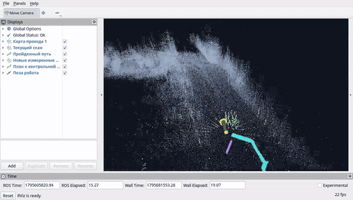
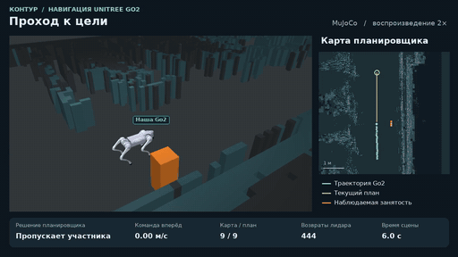
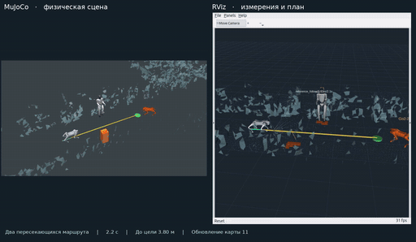
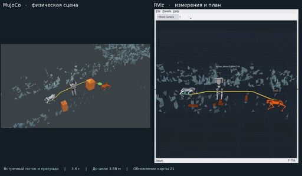
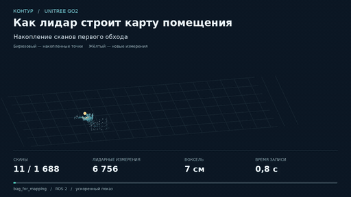
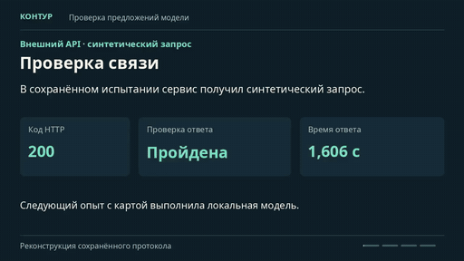

# Контур · 3D-карта и локализация Unitree Go2

Решение кейса МГТС в ROS 2. Первый обход Go2 создаёт измеренную воксельную карту помещения. Во втором обходе робот локализуется в её системе координат и на ходу обновляет слой новых препятствий и маршрут.

- [Данные организаторов](https://github.com/ivr0ma/hackathon/tree/ecbeeb681f7fe1e274402623da27444f63a4c61a/hackathon)
- [Измеренное облако и реконструкция стен](results/map)
- [Контрольные суммы исходных данных](verification/input-provenance.json)

Шаг вокселя 7 см. Результат первого обхода содержит 98 601 точку. Проверку опоры на лидарные измерения прошёл 10 351 треугольник стен.

## Видеодемонстрации

Нажмите на анимацию, чтобы открыть полный MP4.

#### Локализация Go2 по данным организаторов

[](videos/01%20%E2%80%94%20%D0%9B%D0%BE%D0%BA%D0%B0%D0%BB%D0%B8%D0%B7%D0%B0%D1%86%D0%B8%D1%8F%20Go2%20%D0%BD%D0%B0%20%D0%B4%D0%B0%D0%BD%D0%BD%D1%8B%D1%85%20%D0%BE%D1%80%D0%B3%D0%B0%D0%BD%D0%B8%D0%B7%D0%B0%D1%82%D0%BE%D1%80%D0%BE%D0%B2.mp4)

#### Шесть базовых сценариев в MuJoCo

[](videos/02%20%E2%80%94%20%D0%91%D0%B0%D0%B7%D0%BE%D0%B2%D1%8B%D0%B5%20%D0%B7%D0%B0%D0%B5%D0%B7%D0%B4%D1%8B%20Go2%20%D0%B2%20%D1%88%D0%B5%D1%81%D1%82%D0%B8%20%D1%81%D1%86%D0%B5%D0%BD%D0%B0%D1%80%D0%B8%D1%8F%D1%85.mp4)

#### Три робота идут к цели

[](videos/03%20%E2%80%94%20%D0%A2%D1%80%D0%B8%20%D1%80%D0%BE%D0%B1%D0%BE%D1%82%D0%B0%2C%20%D0%BF%D1%80%D0%BE%D1%85%D0%BE%D0%B4%20%D0%BA%20%D1%86%D0%B5%D0%BB%D0%B8.mp4)

#### Обход преграды тремя роботами

[](videos/04%20%E2%80%94%20%D0%A2%D1%80%D0%B8%20%D1%80%D0%BE%D0%B1%D0%BE%D1%82%D0%B0%2C%20%D0%BE%D0%B1%D1%85%D0%BE%D0%B4%20%D0%BF%D1%80%D0%B5%D0%B3%D1%80%D0%B0%D0%B4%D1%8B.mp4)

#### Построение 3D-карты и стен

[](videos/05%20%E2%80%94%20%D0%9F%D0%BE%D1%81%D1%82%D1%80%D0%BE%D0%B5%D0%BD%D0%B8%D0%B5%203D-%D0%BA%D0%B0%D1%80%D1%82%D1%8B%20%D0%B8%20%D1%81%D1%82%D0%B5%D0%BD.mp4)

#### Проверка запроса и предложения модели

[](videos/06%20%E2%80%94%20%D0%9F%D1%80%D0%BE%D0%B2%D0%B5%D1%80%D0%BA%D0%B0%20%D0%BF%D1%80%D0%B5%D0%B4%D0%BB%D0%BE%D0%B6%D0%B5%D0%BD%D0%B8%D1%8F%20%D0%BC%D0%BE%D0%B4%D0%B5%D0%BB%D0%B8.mp4)

## Воспроизведение результата

[Установка, NVIDIA Container Toolkit, CUDA, запуск ROS 2 и MuJoCo с RViz](docs/Запуск-и-GPU.md)

На Ubuntu с Docker и ROS 2 Jazzy выполните из корня проекта:

```bash
./run-contest fetch
./run-contest build
./run-contest gpu
./run-contest map
./run-contest replay
./run-contest audit
./run-contest show
```

Первый bag даёт базовую карту, второй воспроизводится в ROS 2 со скоростью 1×. В начальном режиме seeded используется стартовая одометрия. Эталонная траектория для второго обхода организаторами не предоставлена. В MuJoCo измеренная карта служит средой для повторяемых заездов с движущимися Go2 и G1.

В каталоге `output/official` появятся ROS 2 bag (MCAP), покадровые замеры и обновлённый слой карты. По умолчанию `run-contest` читает `data/` и пишет в `output/`. Для независимого повтора выберите новый путь через `CONTEST_OUTPUT`.

## Результаты для проверки

Запись экрана RViz при воспроизведении официального обхода: [вид сверху](videos/rviz-top.mp4) и [вид от третьего лица](videos/01%20%E2%80%94%20%D0%9B%D0%BE%D0%BA%D0%B0%D0%BB%D0%B8%D0%B7%D0%B0%D1%86%D0%B8%D1%8F%20Go2%20%D0%BD%D0%B0%20%D0%B4%D0%B0%D0%BD%D0%BD%D1%8B%D1%85%20%D0%BE%D1%80%D0%B3%D0%B0%D0%BD%D0%B8%D0%B7%D0%B0%D1%82%D0%BE%D1%80%D0%BE%D0%B2.mp4).

- [Выходной bag ROS 2 в формате MCAP](results/localization/rosbag2) и [покадровые замеры](results/localization/frames.csv). Скачайте оба файла каталога bag и откройте его командой `ros2 bag info results/localization/rosbag2`.
- [Время локализации и доля успешно обработанных сообщений](results/localization/timing.json).
- [Заезды Go2 и G1 в MuJoCo, контакты и расстояния до цели](results/simulation).
- [Измерения CUDA и аппаратного рендеринга EGL](verification/gpu.json).

Для просмотра выходного bag в RViz выполните в двух терминалах с загруженным окружением ROS 2 команды `rviz2 -d hackathon_solution/rviz/top.rviz` и `ros2 bag play results/localization/rosbag2 --clock`.

[Скачать одним файлом .bag](results/localization/localization.mcap.bag). Это те же байты MCAP из выходного bag ROS 2 Jazzy. Формат явно задаётся командой `ros2 bag info -s mcap results/localization/localization.mcap.bag`.

[Независимое чтение опубликованной записи](results/localization/audit.json) подтвердило 1 525 входных сканов, 1 513 опубликованных поз и 205 планов. Время от доступности входа до результата составило 9,57 мс по медиане и 21,52 мс на 95-м процентиле. В 1 523 из 1 524 измеримых интервалов результат появился до следующего скана.
